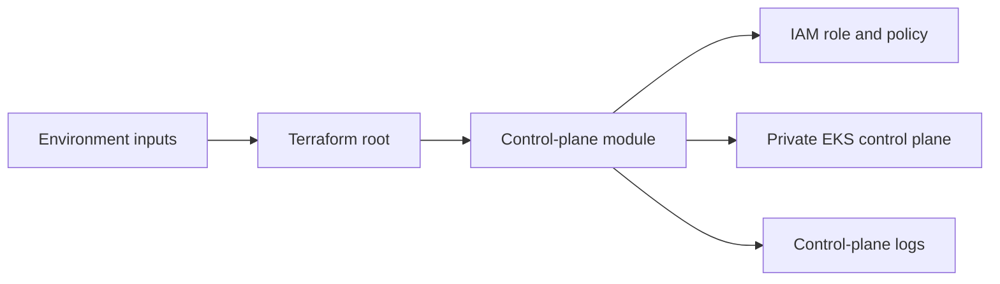

# Terraform EKS Control Plane | Local Mocked Validation

An independent reusable Terraform module for a private Amazon EKS control plane, with an IAM service role, AWS-managed control-plane policy, control-plane logs and environment tags. It uses separate names for `dev`, `qa` and `prod`; account and network isolation are the operator's responsibility.



## Local checks (no AWS credentials required)

Requires Terraform 1.7 or newer; CI uses 1.14.8.

```bash
terraform fmt -check -recursive
terraform init -backend=false -input=false
terraform validate
terraform test
```

The test suite uses only a mocked AWS provider and plan commands. It checks environment naming, private-only access, rejection of unsupported environments and insufficient distinct subnets. The provider lock selects AWS 5.100.0.

## Cloud limitations

The module does not create VPCs/subnets, compute nodes, workloads, remote state, IAM access entries or disaster recovery. An actual EKS apply can incur charges even without worker nodes. Before a separately approved deployment, supply existing private subnets in distinct availability zones, review AWS version support, state isolation, access and costs, and inspect a real plan. No apply is included in CI.

Verified 26 November 2026: formatting, validation and all three mocked plan tests passed locally. No AWS resources were created.
